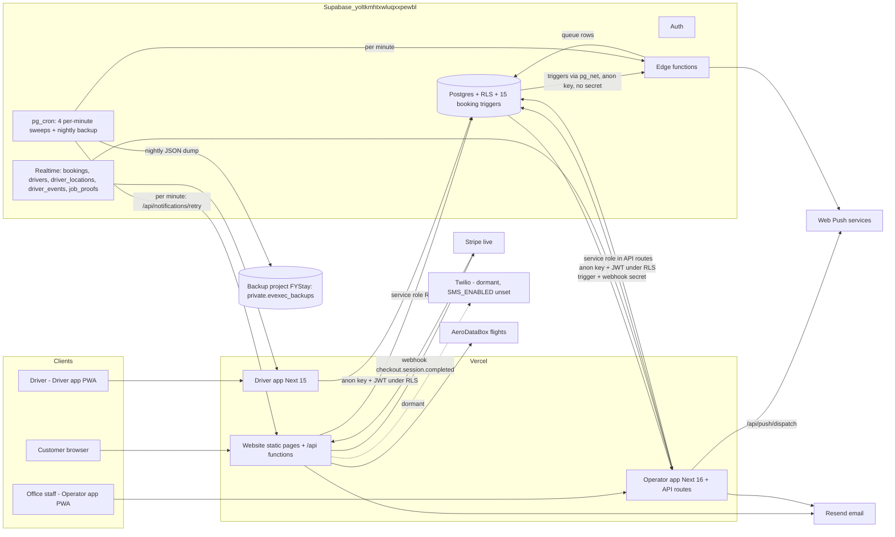

# EV Exec — Phase 1 audit: full ecosystem and SaaS readiness

**Date:** 15/10/2026 · **Type:** audit only (no application code, schema or production data changed) · **Auditor:** Claude Code session

**Commits audited** (each repo checked out detached at `origin/main`, the production branch, with clean working trees and no stashes):

| Repo | Commit | Notes |
|---|---|---|
| `mosssirisom/evexec` (website) | `42696d0` | merge of PR #27 |
| `mosssirisom/evexecoperator` (Operator app) | `6501ff6` | merge of PR #18 |
| `mosssirisom/evexecdriverapp` (Driver app) | `e531b6e` | merge of PR #8 |
| Supabase `yoltkmhtxwluqxxpewbl` ("EV Exec", eu-central-1, Postgres 17) | live | read-only queries only |

**How to read this report.** Every finding is marked **Confirmed** (seen in code *and* in the live database or a test run), **Code-confirmed** (the code path is unambiguous but was deliberately not exercised, because doing so would send real messages or alter data), or **Suspected** (likely, but depends on a setting or behaviour that could not be checked from here). Nothing was exploited. No email, push, SMS or invitation was sent during this audit.

---

## A. Executive summary

### Current verified state

EV Exec runs as three applications on one shared Supabase project:

- **Website**: static HTML plus Vercel serverless functions in `api/`, with `lib/` for shared logic.
- **Operator app**: Next.js 16 and React 18.
- **Driver app**: Next.js 15 and React 19.

The core booking path works end to end today for a single business. A customer books on the website, the booking is priced on the server from `tenants.pricing`, the office accepts it, a driver or partner is assigned, the driver moves it through En Route, Arrived, Passenger On Board and Completed, and customer emails and two-tap texts follow. All five scheduled jobs (`cron.job`) succeeded on every run for the last 7 days (10,080 runs each for the per-minute jobs). Nightly data backups have arrived in the separate backup project every night (latest 14/10/2026 03:17, 37 tables).

The **multi-tenant foundation is real but incomplete**: `tenants`, `tenant_users` and `staff_for_tenant()` scope the core tables. Several trust boundaries are weak, though, and some are exploitable **today** with a single business, not only after a second tenant arrives.

### Readiness, assessed separately

| Level | Verdict | Why |
|---|---|---|
| **Controlled pilot with EV Exec's own business** (already live) | **Acceptable to continue, with P0 fixes urgently** | Bookings flow and are reliable, but C-1 (any signed-in customer can receive the office's booking notifications) and H-1 (forged "job cancelled" alerts to drivers) should be closed now. |
| **Paid single-tenant deployment for another operator** (separate copy) | **Not ready** | Branding, phone numbers, domain, ref prefix and email wording are hard-coded in ~140 files, and the schema can't be rebuilt from the repos (H-4). Each copy would be a manual fork. |
| **Multi-tenant SaaS (second tenant in the same database)** | **Not ready; would leak data** | Push subscriptions, notification settings and 17 tables are global, drivers can rewrite `tenant_id`, and the Driver app and website have no tenant concept. |

### Five biggest risks

1. **C-1: The office's push notifications can be received by any signed-in user.** `register_operator_push` can be called by any account, and anyone can create an account on the website. The dispatch route then pushes every new booking and payment (customer name, route, time, amount) to every registered device.
2. **H-1: Anyone can forge driver alerts.** The `send-push` and `notify-job-update` functions run without authentication and trust the booking record in the request body. Knowing a driver's ID is enough to send them "Job cancelled, do not travel to the collection point", and customers can see their driver's ID via `/api/account`. That could cause a missed airport pickup.
3. **H-2: Drivers can edit anything on their jobs.** Row-level security plus table-wide `UPDATE` grants let an assigned driver change price, payment status, assignment and `tenant_id` on their bookings, and change their own driver record (including `tenant_id` and `kind`).
4. **H-3: Driver app marks jobs paid on a tap.** Choosing Card or Bank Transfer at completion sets `payment_status = 'Paid'` with nothing to verify it, and overwrites `Invoiced` for account customers.
5. **H-4/H-5: The system can't be rebuilt or safely changed.** 54 of the 151 migrations applied in production exist in no repo, there's no staging database, the website and Driver app have no CI test gate, and the Driver app has no tests.

### What is already working (verified)

- Server-side pricing from `tenants.pricing`, with a fallback list (`evexec/lib/pricing.js`). Booking API checks: honeypot, length caps, email format, travel date not in the past (UK date), return not before outbound, 1–16 passengers, at most 5 extra stops.
- Hardened Stripe webhook with idempotent reconciliation (`lib/payments.js`, `stripe_webhook_events`). Website unit tests: **50/50 pass** across 4 files (payments 30, emails 8, reminders 7, pricing 5).
- Operator API routes (`/api/team`, `/api/drivers`, `/api/payment-link`, `/api/send-invoice`) verify staff role and tenant on the server. Operator: **193/193 tests pass**, `tsc` clean, production build OK.
- Driver app: `tsc` clean, production build OK.
- Tenant-scoped RLS (`staff_for_tenant(tenant_id)`) on bookings, drivers, invoices, quotes, messages, missed calls, flight checks and SMS tasks.
- Notification queue swept every minute, with stale-job skipping (`lib/notificationQueue.js`), and emails re-rendered from current booking data when sent.
- The partner and invite work from 14–15/10:
  - `drivers.kind` is live, and James Addy and Marks Taxi are `partner`.
  - The reminder sweep (v4) and confirm-pickup engine (v11) are deployed and returning HTTP 200 every minute.
  - The invite route is unit-tested.
- Booking data integrity:
  - No duplicate refs, no past-dated active bookings, no booking without a travel date.
  - `driver_id` always equals `assigned_driver_id`.
  - Stored `pickup_time` always matches `travel_time` in UK time.

### What remains unverified

- How the operator and driver screens behave once signed in. No test credentials were available, and live sites are blocked by this session's network policy, so only sign-in screens were rendered (locally).
- A real end-to-end invite (email arrives → link → set password → sign-in).
- Supabase Auth settings that aren't readable from SQL: whether email confirmation is required, OTP/recovery link lifetime, leaked-password protection (the advisor says it's off).
- Vercel environment variables, whether preview deployments use the production database (inferred yes, since only one Supabase project serves EV Exec), and rollback history.
- The website Playwright end-to-end suite (needs a running server against a real database; not run, by policy).
- Whether Stripe copies Payment Link metadata into Checkout Sessions (relevant to H-6).

---

## B. Repository inventory

| | Website `evexec` | Operator `evexecoperator` | Driver `evexecdriverapp` |
|---|---|---|---|
| Stack | Static HTML (generated by `scripts/site/build.js`) + Vercel Node functions (`api/*.js`, 8 entry points, ~4,600 lines incl. `lib/`) | Next.js **16.3.6**, React 18, Tailwind 3, vitest | Next.js **15.5.27**, React 19, Tailwind 3, Leaflet |
| Runtime | Node 24 (`engines`) | Node ≥22 (CI uses 22) | not pinned |
| Routes | 30+ marketing pages, `/booking`, `/account`, `/quote`; APIs: booking, operator (email accept/reject), payment, account, notifications, leads, reminders, flight | `/operator/{today,bookings,inbox,drivers,customers,invoices,analytics,settings}`, `/set-password`, `/payment-*`; APIs: team, drivers, booking-response, payment-link, send-invoice, push/{dispatch,subscribe,public-key}, stripe-webhook (test mode), auth/forgot | `/dashboard`, `/jobs`, `/jobs/[id]` (+`reminder`, `receipt`), `/my-jobs`, `/calendar`, `/earnings`, `/notifications`, `/profile`, `/login`, `/forgot-password`, `/reset-password` |
| Data access | Service-role REST from server functions | Browser Supabase client under RLS + service-role API routes | Browser Supabase client under RLS; SSR auth middleware |
| Tests | 4 node unit test files (50 tests, pass); 7 Playwright e2e specs (not run) | 17 vitest files, 193 tests (pass); coverage 34.9 % of *loaded* statements | **None** |
| Lint | none configured | `npm run lint` **broken** (`next lint` was removed in Next 16) | `next lint` not configured (prompts interactively) |
| CI | `deploy.yml` runs `vercel deploy --prod` on every push to `main` (no tests), plus 3 stale self-editing "fix" workflows with `contents: write` | `ci.yml`: `npm ci`, test, build on every push | **None** |
| Deploy | Vercel (Git integration **and** the deploy workflow) | Vercel Git integration | Vercel Git integration |
| Edge functions in repo | — | `manage-tenants`, `notify-operator-new-booking`, `send-sms`, `create-payment-link`, `integration-status`, `verify-flight`, `check-flight` | `send-push`, `notify-job-update`, `send-driver-reminders`, `send-customer-sms-reminder-push`, `attestation-engine`, `send-journey-receipt`, `notify-passenger-arrived`, `driver-test-push` |
| `npm audit --omit=dev` | n/a (no runtime deps) | 3 high (Next cache poisoning advisory, sharp/librsvg, source-map-js), 1 low (dompurify) | 2 high (postcss, source-map-js), 1 moderate |

Deployed edge functions with **no source in any repo**: `track-flight` (no auth), `set-vercel-env`.

---

## C. System architecture



**Verified vs inferred.**
- Verified: the database, triggers, cron jobs and HTTP responses (`net._http_response`), edge functions and their `verify_jwt` settings, the realtime publication, backup arrival, and Vercel production deployments of the three merge commits (GitHub deployment statuses = success).
- Inferred: Vercel environment variables, preview deployments using the production database, and Resend/Stripe account configuration.

---

## D. Booking lifecycle

```mermaid
sequenceDiagram
  autonumber
  participant Cu as Customer
  participant Web as Website /api/booking
  participant DB as Postgres (bookings + triggers)
  participant Q as notification_queue (+/api/notifications/retry each minute)
  participant Op as Operator app
  participant EF as Edge functions
  participant Dr as Driver app / Partner (email)

  Cu->>Web: POST /api/booking/create (button disabled client-side; no idempotency key)
  Web->>Web: validateBooking(), price = tenants.pricing (server)
  Web->>DB: INSERT outbound (status Unassigned, Unpaid, ref EVX-…)
  Web->>DB: INSERT return leg (2nd call, price 0) if return
  DB-->>Op: trg_operator_new_booking_push → /api/push/dispatch (ALL operator devices)
  Web->>Cu: "Request received" email (or office two-tap task if no email)
  Op->>DB: accept: operator_response=accepted (client RLS update) + /api/booking-response sends confirmation email
  Note over Op,DB: Email link alternative: /api/operator/accept sets Dispatched (even without a driver)
  Op->>DB: assign driver: driver_id + assigned_driver_id (+Dispatched)
  DB-->>EF: trg_booking_push → send-push (anon key, no auth)
  DB-->>Q: enqueue_driver_notifications → driver_allocated email + driver_reminder_24h email (scheduled)
  EF-->>Dr: push / email fallback; send-driver-reminders ALSO sends 24h + 1h reminders (duplicate producer)
  Note over Web,Dr: Website cron 09:00 UK: customer 7-day and day-before reminders by email + driver two-tap SMS (partners → office "Texts to send")
  Dr->>DB: status En Route → Arrived → Passenger On Board (direct UPDATE under RLS)
  DB-->>Q: enqueue_operator_customer_notifications → customer status email (two-tap if no email)
  DB-->>EF: trg_notify_job_update → notify-job-update on time/place change or cancel
  Dr->>DB: Completed + payment_method (+ payment_status Paid if Card/Bank Transfer, unverified)
  DB->>DB: ensure_invoice_on_completion, award_journey_points
  Cu->>Web: optional cancel link (HMAC token) → status Cancelled, emails
  Op->>DB: or DELETE booking (password re-check) → row and dependants removed, no customer notice
```

**Status model issues (Confirmed).**
- The `bookings.status` CHECK allows **20 values** with case duplicates (`cancelled`/`Cancelled`, `en_route`/`En Route`, `arrived`/`Arrived`, `active`/`Active`, `completed`/`Completed`) plus legacy states (`pending`, `accepted`, `confirmed`, `rejected`, `CRITICAL_UNALLOCATED`, `Unassigned / Missed Call Recovery`).
- Live data only uses `Dispatched` (18) and `Completed` (53). No `Cancelled` row exists at all, because cancellations are deleted outright (see F-08).
- Each app keeps its own list of "active" or "finished" statuses (website `FINISHED_STATUSES`, driver `ACTIVE_STATUSES`, operator `bookingBuckets.js`, the DB transition trigger).
- `payment_method` holds both `cash` (7 rows) and `Cash` (10 rows).

---

## E. Findings register

Severity: **Critical** = live data exposure or a booking-failure path open to the public; **High** = integrity or security failure, or a blocker for selling; **Medium** = reliability, UX or maintainability with real impact; **Low** = hygiene.

### Critical

**C-1 · Security · Office push notifications open to any signed-in user** — *Code-confirmed*
- **Where:** DB `public.register_operator_push` (SECURITY DEFINER, EXECUTE granted to `authenticated`, no staff check); `public.get_push_dispatch_bundle` returns every row of `operator_push_subscriptions` (no user, role or tenant filter); `evexecoperator/src/app/api/push/dispatch/route.ts` sends to all of them.
- **Evidence:** function bodies read from `pg_proc`. Website sign-up is public: `evexec/account.html:1071` and `index.html:2144` call `sb.auth.signUp`.
- **Impact:** anyone can create a website account, call `/rest/v1/rpc/register_operator_push` with their own browser push endpoint, and then receive every "New booking — name · route · time" and payment notice. That's a live leak of customer personal data (GDPR), and also cross-tenant once a second business exists.
- **Reproduce (do not run against prod):** sign up → `rpc('register_operator_push', {p_endpoint, p_p256dh, p_auth})` → place a test booking.
- **Fix:** add `if not private.is_staff_any() then raise` (or check `tenant_users` staff role) inside `register_operator_push`; add `tenant_id` to `operator_push_subscriptions`, filled from the caller; make the dispatch bundle filter by the booking's tenant; delete existing subscriptions whose `user_id` isn't staff.
- **Test:** RPC as a customer returns an error; dispatch payload excludes non-staff endpoints.
- **Approval:** DB migration (additive) + operator route change.

### High

**H-1 · Security · Forged driver notifications through unauthenticated edge functions** — *Code-confirmed*
- **Where:** `evexecdriverapp/supabase/functions/send-push/index.ts` (lines ~31–60) and `notify-job-update/index.ts` (~42–75). Both deploy with `verify_jwt = false`, check no secret, and read `assigned_driver_id`, `status`, `customer_name` and so on from the request body. Triggers `notify_driver_new_booking` / `notify_driver_job_update` call them with the public anon key.
- **Evidence:** function list (`verify_jwt:false`), source, trigger source. `evexec/api/account/index.js` `BOOKING_FIELDS` returns `assigned_driver_id` to the customer.
- **Impact:** anyone who knows a driver's ID (any customer of that driver) can send push (and email fallback) "Job cancelled — do not travel" or "job updated" messages with any text → a missed airport pickup.
- **Fix:** have the trigger send a shared secret (as `notify-operator-new-booking` already does) and check it constant-time; better, pass only `booking_id` and read the booking with the service role. Also stop returning driver IDs to customers.
- **Test:** POST without the secret → 401; forged body ignored.
- **Approval:** edge function deploy + DB function update.

**H-2 · Security / integrity · Drivers can write any column on their bookings and their driver record** — *Confirmed (policy + grants)*
- **Where:** policies `bookings_driver_update` and `drivers_self_update`. `authenticated` holds UPDATE on all 70 `bookings` columns and on `drivers`, with no column-guard trigger.
- **Impact:** an assigned driver (or a partner if they ever get a login) can call the REST API directly to set `quoted_price`, `payment_status='Paid'`, `assigned_driver_id`, `customer_*` and `tenant_id`, and change their own `tenant_id`, `kind` or `email`. With several tenants this becomes cross-tenant **write** access (Critical for SaaS).
- **Fix:** replace direct driver UPDATE with security-definer RPCs (`driver_set_status`, `driver_add_note`, `driver_complete(payment_method)`) that check the transition and the caller; or add a BEFORE UPDATE trigger that rejects changes to protected columns when the caller isn't staff; revoke column UPDATE except the needed few.
- **Test:** as a driver, PATCH `quoted_price`/`tenant_id` → refused.
- **Approval:** DB migration + Driver app changes.

**H-3 · Integrity · Driver completion marks bookings Paid without verification** — *Code-confirmed*
- **Where:** `evexecdriverapp/app/(app)/jobs/[id]/page.tsx` `handleComplete` (~line 695): `...(paymentMethod !== 'Cash' ? { payment_status: 'Paid' } : {})`.
- **Impact:** Bank Transfer "Paid" before money arrives; an `Invoiced` account job flips to `Paid`; a prepaid card job where the driver taps Cash gets `payment_method='Cash'`. Office reports and customer invoices go wrong.
- **Fix:** the driver records "collected by card machine / cash / not collected"; only the Stripe webhook or office staff set `Paid`; never overwrite `Paid`/`Invoiced`.
- **Test:** complete an invoiced job as a driver → status stays `Invoiced`.

**H-4 · Operability · Schema not reproducible; no staging** — *Confirmed*
- **Evidence:** `list_migrations` shows 151 applied; the union of the three repos has 107 distinct migration names, so 54 applied migrations have no file anywhere (e.g. `create_bookings_table`, `notification_queue_infrastructure`, `security_hardening_full_audit`). Applied versions differ from file timestamps (e.g. `driver_kind_partner` applied as `20261015011726`, file `20261015150000`). Migrations are split across three repos. Supabase has only the production project plus the backup project ("FYStay").
- **Impact:** you can't build a test database, a new tenant environment or a disaster-recovery copy from source; every schema change is tested in production. Vercel previews almost certainly use the production database (inferred).
- **Fix:** generate one baseline (`supabase db dump --schema-only`) into a single `supabase/` home (the website repo already holds recent ones), mark the existing history as applied, and from then on only add migrations there. Use the free local Supabase CLI stack for tests; ask before any paid branch.

**H-5 · Quality · No CI gate on the website and Driver app; Driver app has no tests; lint broken** — *Confirmed*
- **Evidence:** `evexec/.github/workflows/deploy.yml` deploys to production on push without running tests (Vercel Git integration *also* deploys, so production is built twice). The Driver app has no workflow and no test files. `npm run lint` fails in Operator (Next 16 removed `next lint`) and prompts in Driver. Operator coverage is 34.9 % of loaded statements (whole-repo coverage is lower).
- **Fix:** add a CI workflow to the website (`npm run test:unit`, `node --check`) and the Driver app (`tsc`, build, new tests); move both Next apps to the ESLint CLI; drop the duplicate deploy workflow and the three stale "fix" workflows.

**H-6 · Security · Edge functions callable by any signed-in user without a staff check** — *Code-confirmed (impact partly Suspected)*
- `create-payment-link` (`evexecoperator/supabase/functions/create-payment-link`, `verify_jwt` true but no role check, CORS `*`) creates **live** Stripe Payment Links with any amount and any `metadata[booking_ref]`. Any customer could create a genuine-looking EV Exec payment page. If Stripe copies Payment Link metadata into the Checkout Session (not verified), paying 1p would let `reconcileCheckoutSession` mark the referenced booking Paid (amount differences are flagged, never blocked). No app code calls this function; it's dead.
- `send-sms`: same pattern; harmless while Twilio is dormant, dangerous if `SMS_ENABLED` is ever set.
- `integration-status`: tells any user which integrations are configured.
- `send-journey-receipt` and `notify-passenger-arrived` (`verify_jwt` false, no auth): anyone with a booking ID can re-send receipt or arrival emails to the customer. `notify-passenger-arrived` was recorded as deleted on 24/09 but is **still deployed (v9) and still in the repo**.
- `track-flight` (`verify_jwt` false) and `set-vercel-env`: deployed, **source in no repo**; behaviour unknown.
- **Fix:** delete the unused ones (`create-payment-link`, `notify-passenger-arrived`, and `track-flight`/`set-vercel-env` after confirming they're unused); add staff checks to the rest; restrict CORS to the app origins.

**H-7 · SaaS · Multi-tenant blockers (Critical before a second tenant)** — *Confirmed*
- Global, not tenant-owned: `operator_push_subscriptions`, `push_config` (one VAPID pair and secret), `notification_channel_settings` (single row, `id boolean`), `notification_queue`/`notification_log` (no `tenant_id`), plus 13 more tables without `tenant_id` (see the 2026-09-22 audit; 4 of them are scoped through joins).
- The website is hard-wired to one tenant (`lib/pricing.js` `TENANT_ID` default; `tenant_id` comes from the column default on insert); the Driver app has no tenant concept; `ref` CHECK `^EVX-`; brand name, phone and domain are hard-coded in 78 / 45 / 20 files (website / operator / driver); emails always say "EV EXEC" and 07721 070370; a super_admin silently acts on "the first tenant" (`lib/server/staff.ts`).
- Scheduled jobs (reminders, attestation, sweeps) run across all bookings with EV Exec wording and the EV Exec office email.
- **Fix:** see section I.

### Medium

**M-1 · Notifications · Two producers of the driver 24-hour reminder** — *Confirmed*
- The `enqueue_driver_notifications` trigger queues `driver_reminder_24h` emails (12 pending now, 20/10/2026–09/06/2027), while `send-driver-reminders` (cron, every minute) also sends 24h and 1h reminders by push with email fallback. Its header comment says "the database no longer queues its own", which is wrong.
- History shows 5 bookings with two 24h reminder emails each (one failed under the old direct-send path, one sent). Now that the edge function queues through the website, both are likely to send.
- **Fix:** delete the trigger's reminder branch (keep `driver_allocated`) and the 12 pending rows; keep the edge function as the only producer.

**M-2 · Notifications · Queued reminders don't move when the pickup time changes** — *Code-confirmed*
- The trigger reschedules only on driver change. A time edit leaves `next_attempt_at` at the old time (the email is re-rendered when sent, but sent at the wrong moment). This goes away once M-1 is fixed.

**M-3 · Operator · Inbox doesn't update live** — *Confirmed*
- `useQuoteRequests`, `useMissedCalls`, `useContactMessages`, `useAuditLog` and `useDriverAvailability` subscribe to realtime on tables that aren't in the `supabase_realtime` publication (only `bookings`, `drivers`, `driver_locations`, `driver_events` and `job_proofs` are), and they don't poll. New quote requests, missed calls and website messages don't appear (and the Inbox badge doesn't change) until the page is reloaded.
- **Fix:** add the tables to the publication (free) or poll every 60 s like the bookings list.

**M-4 · Lifecycle · No-show recorded as Cancelled** — *Code-confirmed*
- Driver "No show" sets `status='Cancelled'` (`jobs/[id]/page.tsx` ~line 727) even though `No Show` is an allowed status. The trigger then sends the customer "your booking has been cancelled… contact us if unexpected" and the driver a "job cancelled" push. Reporting can't tell no-shows apart.
- **Fix:** use `No Show`, and add a customer message specific to it.

**M-5 · Data · Bookings are hard-deleted** — *Confirmed*
- Operator "Delete" (`useBookings.js` ~line 607, with a password re-check) removes the row; invoices, reminders and SMS tasks cascade; the customer isn't told; there's no audit trail of the delete. Zero `Cancelled` rows exist, so cancellation is handled by deletion.
- **Fix:** make Delete a soft "Cancel" with a reason (sending the customer notice), and keep true delete for test or duplicate data only (admin).

**M-6 · Security · Driver access matches by email** — *Suspected (depends on Auth settings)*
- `bookings_driver_select/update`, `drivers_self_*` and `driver_sms_reminders` policies also allow access when `drivers.email = auth.email()`. If email confirmation were ever off, anyone signing up with a partner's or driver's email would get their jobs and customer details. All 4 current users are confirmed.
- **Fix:** now that drivers log in with `drivers.id = auth.uid()` (invite flow), remove the email clauses.

**M-7 · Invites · Link lifetime and revocation** — *Suspected / Code-confirmed*
- Invites use a recovery link, so they expire with the Auth OTP lifetime (Supabase default 1 hour; actual setting unverified). Drivers opening the email later get "expired".
- Deleting a driver, or switching them to partner, leaves their login and `tenant_users` `driver` role in place.
- **Fix:** longer OTP expiry or our own invite tokens; revoke the role and login on delete or kind change.

**M-8 · Booking API · No idempotency or rate limit; partial return-leg failure** — *Code-confirmed*
- `create()` inserts the outbound leg, then the return leg in a second call. If the second call fails, the customer sees "Failed to save booking" although the outbound was saved, and a retry creates a duplicate. There's no idempotency key and no rate limit (only the honeypot), and `travel_time` format and same-day past times aren't validated.
- **Fix:** insert both legs in one RPC/transaction; accept an idempotency key from the form; reject past same-day times.

**M-9 · Customer cancel link** — *Code-confirmed*
- `handleCancel` doesn't check `payment_status`, so it tells a customer who paid by card "No payment has been taken", and no refund task is created. It also allows cancelling at `Arrived`.
- **Fix:** branch on payment status and create a refund task for the office.

**M-10 · Operator · Two booking data layers** — *Confirmed*
- `CalendarApp.tsx` uses the legacy `src/hooks/useBookings.ts`/`useDrivers.ts`; every other screen uses `src/hooks/operator/*.js` (different shaping, different assign/delete code). Same risk of drift as before.
- **Fix:** move the calendar onto the operator hooks and delete the legacy ones.

**M-11 · Email accept link sets Dispatched without a driver** — *Code-confirmed*
- `evexec/api/operator/index.js:68`. Live data currently has none, but the board would show "driver assigned" states with no driver. There are two accept paths (email link and Operator app) with different status effects.

**M-12 · booking-response callable by non-staff** — *Code-confirmed*
- `evexecoperator/src/app/api/booking-response/route.ts` only checks that the caller has a session; the booking read runs under RLS, so the customer, or the assigned driver, can trigger "confirmed" or "unavailable" emails for that booking.
- **Fix:** require a staff role, as `/api/payment-link` does.

**M-13 · Backups are data-only and unrehearsed** — *Confirmed*
- `private.run_evexec_backup()` posts JSON copies of public and private tables to the FYStay project (37 tables nightly, arriving) by fire-and-forget `pg_net`. It doesn't include the schema, functions, `auth.users`, storage files or vault secrets, and no restore has been tested. The project name suggests a prototype holding production personal data.
- **Fix:** write and rehearse a restore runbook; include auth export; consider renaming or isolating the backup project; ask about Supabase PITR (paid) before relying on it.

**M-14 · Accessibility (WCAG 2.2 AA)** — *Confirmed*
- Driver app secondary text colours fail contrast on its backgrounds: `#7a9ab8` 2.9:1 on white / 2.6:1 on `#eaeff7` (133 uses); `#a8c0d4` 1.9:1 / 1.6:1 (25 uses); gold `#d5a538` as text 2.3:1 (140 uses, including "Forgot password?").
- The Operator app already moved to a 5:1 gold (`#8A6A1F`); the Driver app hasn't.
- Sign-in forms in both apps: the two inputs aren't programmatically labelled (visible labels aren't linked), there's no `<h1>`, and `lang="en"` rather than `en-GB`.
- Website homepage: 8 unlabelled inputs (booking wizard), ~30 tap targets under 24 px.

**M-15 · Observability** — *Confirmed*
- No error tracking or alerting in any app (no Sentry or similar); Vercel keeps logs about an hour; `error_log` exists, but alerting on failed notifications or cron is absent.
- 15 triggers on `bookings`, including the same status-transition function attached twice (`booking_status_transition` and `enforce_booking_status_transition`) and two driver-sync triggers, make behaviour hard to reason about.

**M-16 · Dependencies** — *Confirmed*
- The npm audit highs listed in B. The Operator app (Next 16 / React 18) and Driver app (Next 15 / React 19) are on different major versions, and their Supabase JS versions trail the latest.

### Low

- **L-1:** `anon` and `authenticated` hold `TRUNCATE`/`TRIGGER`/`REFERENCES` on tables (PostgREST can't use them; revoke for defence in depth).
- **L-2:** 24 unused indexes, 9 RLS policies re-evaluating `auth.*()` per row, 41 "multiple permissive policies" (advisor). Performance, not correctness, at current volume.
- **L-3:** CORS `*` on several operator edge functions.
- **L-4:** Reminder texts in "Texts to send" use the wording generated at cron time ("in 6 days"). The Driver app regenerates at tap time; the office list doesn't.
- **L-5:** Customers of partner jobs get no En Route or Arrived updates unless the office changes the status (partners have no app).
- **L-6:** `driver_messages` table and its one row left from the removed Chat tab.

---

## F. Functional coverage matrix

Legend: ✅ verified working · ❌ verified broken · ◐ partial · ❔ unverified · ⛔ intentionally disabled

| Area | Action | Status | Evidence |
|---|---|---|---|
| Website | Booking create (validation, server price, insert) | ✅ code + data | `api/booking/index.js`; 58 website bookings; unit tests for pricing |
| Website | Duplicate-submit protection | ◐ | button disabled client-side only (M-8) |
| Website | Return leg creation | ◐ | separate insert, partial-failure risk |
| Website | Customer cancel link | ◐ | works; wrong message for paid bookings (M-9) |
| Website | Card payment + webhook reconcile | ✅ | 30 unit tests in `payment-webhook.test.cjs`; live webhook delivery verified 07/10 (`CLAUDE.md`) |
| Website | Pay cash | ❔ | code read only |
| Website | Account / invoices / points | ❔ | code read; not exercised |
| Website | Quote form → office | ◐ | saved + emailed; Operator Inbox not live (M-3) |
| Website | Customer reminders (email + two-tap) | ✅ | unit tests; cron 200s |
| Operator | Sign-in, forgot password | ✅ render / ❔ submit | screenshot; route tested |
| Operator | Today, Bookings list/board/calendar | ❔ | needs login; unit tests for buckets |
| Operator | Accept / reject | ◐ | works; endpoint not staff-restricted (M-12) |
| Operator | Assign driver / partner | ✅ data | `driver_id` = `assigned_driver_id` in all 71 rows |
| Operator | Delete booking | ◐ | hard delete (M-5) |
| Operator | Inbox live updates | ❌ | tables not in realtime publication (M-3) |
| Operator | Team invite / roles | ✅ tests | `team.test.ts` |
| Operator | Driver invite / app status | ✅ tests / ❔ live email | `drivers.test.ts` |
| Operator | Texts to send | ✅ tests / ❔ UI | `textTasks.test.js` |
| Operator | Settings: business, prices, branding | ❔ | RPCs check role (verified in SQL) |
| Operator | Push alerts on this device | ◐ | works, but C-1 |
| Driver | Sign-in, set password from invite | ✅ render / ❔ flow | screenshot; `verifyOtp` code |
| Driver | Jobs list, live updates | ❔ | realtime on bookings is published |
| Driver | Swipe status | ✅ data | `booking_audit_log`: En Route 54, Passenger On Board 52, Completed 52, Arrived 22 (Arrived is often skipped) |
| Driver | Complete + payment | ◐ | marks Paid unverified (H-3) |
| Driver | No show | ◐ | recorded as Cancelled (M-4) |
| Driver | Week-ahead / day-before reminder texts | ✅ code | prior verified work |
| Driver | Chat | ⛔ | removed 14/10 |
| Backend | Cron sweeps (5) | ✅ | 7-day success, HTTP 200 |
| Backend | Driver 24h reminder | ◐ | duplicate producers (M-1) |
| Backend | Partner exclusion (sweep, attestation) | ✅ | deployed v4/v11, 200s |
| Backend | Nightly backup | ✅ arrival / ❔ restore | backup project rows |
| SMS (Twilio) | All sends | ⛔ | `SMS_ENABLED` unset; queue logs "Twilio dormant" |

---

## G. Cross-repository contract matrix

| Contract | Website | Operator | Driver | DB | Mismatch |
|---|---|---|---|---|---|
| Driver link | reads `assigned_driver_id` (reminders), `assigned_driver_id‖driver_id` (account, email render) | writes **both**, reads `driver_id` first | reads/filters `assigned_driver_id` | two sync triggers keep them equal | ⚠ two columns for one fact |
| Status values | creates `Unassigned`; cancel → `Cancelled`; finished list lower-cased | Title-case set + legacy | `En Route`/`Arrived`/`Passenger On Board`/`Completed`; no-show → `Cancelled` | CHECK allows 20 incl. lower-case | ⚠ M-4, sprawl |
| Payment status / method | `Unpaid`/`Paid`; `Card`/`Cash` | `Paid`/`Unpaid`/`Invoiced`; `Bank Transfer` | sets `Paid` on Card/Bank | data has `cash` + `Cash` | ⚠ H-3, case |
| Driver vs partner | n/a (reminder handoff by `assigned_driver_id`) | `drivers.kind` UI | no kind awareness (partners never log in) | `drivers.kind` | ✅ (edge functions filter) |
| Driver name/vehicle | reads `full_name`, `vehicle_model`, `vehicle_registration` | writes `name`, `vehicle`, `plate` | reads `full_name`… | both column sets exist | ⚠ customer emails miss names for operator-added drivers unless the invite filled `full_name` |
| Office push | `/api/push/dispatch` with `{notification}` + secret | route accepts `{record}` or `{notification}` | sweep → same route | trigger → same route | ✅ (C-1 aside) |
| Driver push | — | — | `push_subscriptions` | triggers → `send-push`/`notify-job-update` with anon key | ⚠ H-1 |
| Booking ref | generates `EVX-…`; lookup requires `EVX-` | displays | displays | CHECK `^EVX-` | ⚠ tenant-specific |
| Pricing | `tenants.pricing` (server) | `tenants.pricing` (suggestion) | n/a | RPC-validated | ✅ marketing pages still built-in |
| Dates | `fmtDate` DD/MM/YYYY | `dates.ts` | `format.ts` | `to_char` | ✅ house style |

---

## H. UI / UX audit

**Rendered locally at 390×844, 820×1180 and 1366×900:** website home, prices and quote; Operator and Driver sign-in; Driver set-password. No page scrolls horizontally at any size. Screenshots are in `docs/audits/screenshots/`.

- **Three visual languages.** The website is dark navy with serif headings and gold italics (luxury). The Operator app is a white UI on a navy shell, Inter, soft gold `#C9A550`. The Driver app is a pale blue-grey (`#eaeff7`) with the original orange-gold gradient buttons and 575 hard-coded hex colour classes (17 distinct). No shared tokens: Operator uses a remapped Tailwind `amber` scale, Driver uses literal hex, the website has its own CSS. The same brand gold appears in three different values.
- **Sign-in screens** are clear and minimal (good), but they hard-code "you@evexec.co.uk" and "Account access is managed by EV Exec", and their labels aren't linked to their inputs (screen readers announce unlabelled fields).
- **Contrast** in the Driver app fails AA for secondary text and gold text (M-14), which matters for drivers reading in daylight.
- **Website homepage on a phone:** the cookie banner covers the main Book / Quote area on first visit (expected, but it competes with the primary action). ~30 tap targets are under 24 px (footer and inline links).
- **Feedback states:** the Driver app shows inline errors on failed updates (good). The Operator app uses `window.confirm` for destructive actions in two places (team removal, invoice delete), not the app's own dialogs. Ten empty `.catch(() => {})` handlers across the two apps swallow errors silently.
- **Not inspected (needs sign-in):** Operator Today, Bookings, drawer and settings; Driver dashboard and job screen. Recommended as the first task of phase 2 with a test account.

**Design-system recommendation.** One small token set shared by all three apps (as CSS variables, generated into each Tailwind config):
- Colour: `--brand-navy #0B132B`; `--brand-gold #C9A550` for fills and buttons only; `--brand-gold-text #8A6A1F` for gold text, ≥5:1; `--text #0F1B33`; `--text-muted #475569`, ≥7:1; plus semantic `success`, `warning`, `danger` and `info` pairs (fill and text).
- Type: Inter for apps, the serif for marketing only.
- Spacing: 4 px base. Radius: 12 / 16 / 24.
- Components: one Button (primary, secondary, danger, ghost; loading state), one Field (label linked, hint, error), one Dialog (replaces `confirm()`), one Status pill driven by a single status map.

Tenant colours from `tenants.brand.colors` feed `--brand-*` at runtime. Do this before tenant branding, so the branding has one place to plug into.

---

## I. SaaS architecture proposal

**Recommendation for this stage: one shared database and shared code (pooled multi-tenancy), tenant resolved per request, no customer forks.** This is the cheapest model that can be sold repeatedly, and the schema is already shaped for it.

1. **Tenant ownership everywhere.** Add `tenant_id` (NOT NULL, FK, indexed) to:
   - per-booking or per-person tables: `notification_queue`, `notification_log`, `operator_push_subscriptions`, `push_subscriptions`, `driver_*`, `booking_*`, `job_proofs`, `saved_addresses`;
   - `notification_channel_settings`, converted to one row per tenant;
   - `push_config`: keep it global (one VAPID key is fine) but route by tenant.

   Backfill from the owning booking, driver or user (all current rows → EV Exec). Then write RLS as `staff_for_tenant(tenant_id)` or "own row", and add `tenant_id` checks to every security-definer RPC and edge function.
2. **Close the write paths first** (H-2, C-1, H-1). Tenant isolation is meaningless while drivers can rewrite `tenant_id`.
3. **Tenant resolution.**
   - Website: map `Host` header → `tenants.domain` (new column) in one place (`lib/tenant.js`) used by pricing, branding, emails and booking insert.
   - Operator: from the staff member's `tenant_users`, with a tenant switcher for super_admin.
   - Driver app: from the driver row.
   - Background jobs: iterate bookings with their tenant and load that tenant's brand.
4. **Configuration, not code.** `tenants` already holds `brand` (logo, colours, invoice) and `pricing`. Add:
   - `domain`, `ref_prefix` (replace the `^EVX-` CHECK with a per-tenant check or a generated ref), `timezone` (default Europe/London), `sender_email`/`reply_to`, `support_phone`, `features` jsonb (flight checks, points, partner workflow), `booking_rules` jsonb (lead time, max passengers, extra-stop price).
   - Render every email, SMS and push from these (the website and operator templates already have a single builder each, `lib/emailContent.js`).
5. **Secrets per tenant** only where a tenant brings their own provider (Stripe Connect account already modelled as `stripe_connect_account_id`; Resend sender domains). Store them in Supabase Vault, keyed by tenant; never in `tenants.brand`.
6. **One migrations home and a staging project.** Use the free local Supabase CLI for tests; a hosted staging project costs money (needs your approval).
7. **Shared code.** Don't jump to a monorepo yet. First move the duplicated domain rules into the database, where all three apps already meet: status transitions, payment rules and pricing as SQL functions or RPCs. Then publish a small shared `@evexec/domain` package (status map, formatters, types generated with `supabase gen types`) consumed by Operator and Driver. Revisit a monorepo only if the package churns.

**Migration path:**
- Phase 2a: P0 security fixes.
- Phase 2b: migrations baseline and CI.
- Phase 2c: `tenant_id` backfill table by table (additive, then NOT NULL, then RLS swap, one table per migration, each verified with a rolled-back test).
- Phase 2d: tenant resolution in the website and jobs.
- Phase 2e: branding and wording from the tenant row.
- Phase 2f: provisioning UI on `manage-tenants` (create tenant → invite operator_admin → wizard for brand, prices, domain → verification checklist).

**What can wait until demand is proven:** subscription billing (invoice the first customers manually), usage limits, custom domains with automated SSL (start with subdomains), per-tenant data export UI (do it by script on request), advanced analytics.

**Needed before the first paying tenant:** isolation (all of P0 + H-7), the provisioning checklist, a data processing agreement and privacy notice listing EV Exec as processor, per-tenant sender identity, and backup/restore that can restore one tenant.

**Onboarding checklist (target):**
1. Create the tenant (slug, name, domain, timezone, ref prefix).
2. Invite the operator_admin.
3. Set brand (logo, colours) and the invoice letterhead.
4. Set prices and booking rules.
5. Set sender email (verify the domain in Resend) and support phone.
6. Invite drivers / add partners.
7. Optional: connect Stripe.
8. Place a test booking end to end in a sandbox mode.
9. Go live.

---

## J. Prioritised remediation roadmap

| ID | Task | Repo | Depends | Acceptance criteria | Tests | Approval |
|---|---|---|---|---|---|---|
| **P0-1** | Staff-only `register_operator_push`, tenant/user filter in dispatch bundle, purge non-staff subscriptions (C-1) | DB, operator | — | Customer RPC call fails; only staff endpoints receive pushes | SQL test as customer; route unit test | DB migration + deploy |
| **P0-2** | Secret-gate `send-push`/`notify-job-update`, read the booking server-side; stop exposing driver IDs to customers (H-1) | driver functions, DB, website | — | Unsigned POST → 401; forged body has no effect | function unit test; manual signed call | function deploy + DB |
| **P0-3** | Driver write restrictions: protected-column trigger or RPCs; remove email-match policy clauses (H-2, M-6) | DB, driver | — | Driver PATCH of price/tenant/payment refused; normal swipes still work | SQL tests per column; Driver app smoke | DB migration + deploy |
| **P0-4** | Driver completion must not set Paid or overwrite Invoiced (H-3) | driver | P0-3 | Invoiced stays Invoiced; Paid only via webhook/staff | new Driver app unit test | deploy |
| **P0-5** | Delete dead/unsourced functions (`create-payment-link`, `notify-passenger-arrived`, `track-flight`/`set-vercel-env` after confirming); staff checks on `send-sms`, `integration-status`, `booking-response`, `send-journey-receipt` (H-6, M-12) | operator, driver | — | Non-staff calls → 403 | route/function tests | deploy |
| **P1-1** | Single migrations home + schema baseline; free local Supabase for tests (H-4) | evexec | — | `supabase db reset` locally reproduces prod schema | CI runs it | none (repo only) |
| **P1-2** | CI for website and Driver app; fix lint in both Next apps; remove duplicate deploy + stale workflows (H-5) | all | — | PRs blocked on red | — | repo only |
| **P1-3** | One driver-reminder producer; purge 12 pending trigger rows (M-1, M-2) | DB | — | One 24h reminder per job | SQL + function test | DB migration |
| **P1-4** | Realtime/polling for Inbox and the other unpublished tables (M-3) | DB/operator | — | New quote appears within 60 s without reload | hook test | DB (publication) |
| **P1-5** | No Show status + customer wording (M-4); soft-cancel instead of delete (M-5); paid-aware cancel link (M-9); accept link mustn't set Dispatched without a driver (M-11) | all | P0-3 | Correct customer message per case | unit tests per path | deploy |
| **P1-6** | Atomic booking + return leg, idempotency key, past-time validation (M-8) | website/DB | — | Retry never duplicates | unit tests | deploy |
| **P1-7** | Invite expiry and revocation (M-7) | operator | — | Link valid ≥ 24 h (or resend clear); delete revokes access | route tests | Auth setting change |
| **P1-8** | Restore runbook + rehearsal; include auth export (M-13) | ops | P1-1 | Documented, timed restore into a local stack | — | none (free local) |
| **P1-9** | Error tracking/alerting on cron and notification failures (M-15) | all | — | Failed sends alert the office | — | ask if any paid tool |
| **P1-10** | Dependency updates (Next patches, postcss) (M-16) | operator, driver | P1-2 | `npm audit` no highs | CI | deploy |
| **P2-1** | Shared design tokens; Driver app contrast; labelled inputs; replace `confirm()` (M-14, H) | all | — | AA contrast on all text; axe check clean on key screens | Playwright + axe | deploy |
| **P2-2** | Consolidate operator data layer (M-10); one status map shared by apps; normalise `payment_method` case; drop duplicate triggers | operator, DB | P1-1 | One hooks set; CHECK lists only used values | unit tests | DB migration |
| **P2-3** | Signed-in UI audit of Operator and Driver screens with a test account | — | test account | Findings logged | — | none |
| **P3-1** | `tenant_id` on remaining tables + tenant-aware jobs and push (H-7) | DB, all | P0-*, P1-1 | Cross-tenant SQL tests pass | tenant isolation suite | DB migrations |
| **P3-2** | Tenant resolution (host → tenant), config-driven brand/wording/ref prefix | all | P3-1 | Second test tenant renders its own brand everywhere | e2e on two tenants | deploy |
| **P3-3** | Provisioning flow on `manage-tenants` + checklist | operator | P3-2 | New tenant live without code changes | e2e | deploy |
| **P3-4** | Billing/plans (only after demand) | — | — | — | — | paid services need approval |

**Before continuing the EV Exec pilot comfortably:** P0-1 … P0-5, P1-3, P1-4.
**Before accepting any other operator:** everything above plus P1-1, P1-2, P1-8 and all of P3-1 … P3-3.

---

## K. Test and verification results

| Command (where) | Result |
|---|---|
| `npm run test:unit` (evexec) | **50 passed, 0 failed, 0 skipped** |
| `node --check` on all `api/**/*.js` and `lib/*.js` (evexec) | all OK |
| Playwright e2e (evexec) | **not run**: needs a running server and real database; standing policy |
| `npx tsc --noEmit` (operator) | clean |
| `npx vitest run` (operator) | **193 passed** (17 files) |
| `npx vitest run --coverage` (operator) | 34.92 % statements of loaded files (739/2116) |
| `npm run lint` (operator) | **fails**: `next lint` removed in Next 16 |
| `next build` (operator) | success |
| `npx tsc --noEmit` (driver) | clean |
| `npm run lint` (driver) | **not configured** (interactive set-up prompt) |
| `next build` (driver) | success |
| Driver tests | **none exist** |
| `npm audit --omit=dev` | operator 3 high / 1 low; driver 2 high / 1 moderate |
| Supabase security advisor | 1 anon-callable + 10 authenticated-callable SECURITY DEFINER functions (C-1 is the real issue among them), 4 RLS-no-policy tables (intentional: service-only), leaked-password protection off |
| Supabase performance advisor | 4 unindexed FKs, 9 initplan policies, 24 unused indexes, 41 multiple-permissive warnings |
| Cron (`cron.job_run_details`, 7 days) | all 5 jobs 100 % succeeded; no non-200 HTTP responses in 24 h |
| Live data integrity queries | see section A ("what is working") |
| Local render (Playwright 1.56, Chromium 1194) | 18 screenshots; no horizontal scroll; metrics in section H |

**Environment assumptions and limits:**
- Repos checked out detached at `origin/main` for the audit (no branch changed, nothing committed besides this report).
- Live Vercel sites are blocked by this session's network policy, so I couldn't load them.
- No test login was available, so signed-in screens weren't checked.
- Supabase Auth configuration isn't readable from here.
- Local servers pointed at the production Supabase URL with the public key, and only sign-in screens were loaded.

---

## L. Go-live checklist (controlled testing with EV Exec's own business)

**Before each change:**
1. Change lands on a branch with CI green (once P1-2 exists).
2. DB change written as an additive migration in the single migrations folder, reviewed, and tested in a rolled-back transaction or a local stack.
3. Note the current Vercel production deployment ID for each app (rollback target) and the current edge function version.

**Deploy:**
4. Apply the migration, then deploy functions, then merge the app PRs (Vercel deploys `main`).
5. Check that GitHub deployment statuses are `success` for each repo.

**Verify, with a test booking on a test customer email you own and the office's own phone:**
6. Website booking → request-received email arrives once.
7. Office push arrives on staff devices only (P0-1).
8. Accept in the Operator app → confirmation email with Pay link.
9. Assign your own driver account → driver push and email once. Edit the time → driver "job updated" once. Day-before reminder once (M-1).
10. Swipe En Route → Arrived → POB → Completed (Cash) → customer status emails, invoice created, payment stays Unpaid/Cash.
11. Assign a partner instead → partner gets the job email; no driver push; customer reminder appears in "Texts to send"; confirm-pickup engine doesn't alert.
12. Cancel via the customer link → correct message for an unpaid booking.
13. Check `notification_queue` for failed or duplicate rows for the test booking (SQL).

**Rollback:** redeploy the previous Vercel production deployment (Vercel → Deployments → Promote); redeploy the previous edge function version from git; DB changes are additive, so revert by a follow-up migration (no DROP of data).

**After:** delete the test booking (or mark it cancelled once soft-cancel exists) and record the result in the repo's `CLAUDE.md`.
